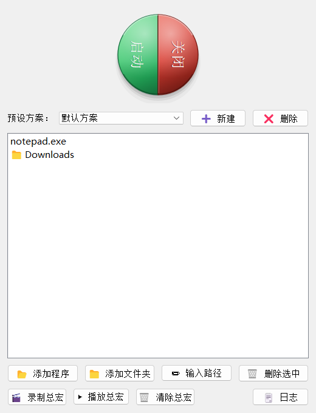

# 一键多启 · LaunchForge

[](https://github.com/weijianluo114-ux/Start_All/actions/workflows/build.yml)

把常用程序与文件夹编成「预设方案」，**一键批量启动**、**安全批量关闭**的 Windows 桌面启动器。
基于 Python + PyQt5，打包为单文件绿色版：无安装、无后台服务、不写注册表。



## 特性

| 能力 | 说明 |
|---|---|
| 顶部太极圆盘 | 左半绿=一键启动、右半红=关闭全部；3D 质感，启动中左半自动置灰 |
| 预设方案 | 多套方案自由切换，改动即时保存，无「保存」按钮 |
| 一键启动 | 按列表顺序启动全部条目；程序并发、文件夹随后打开 |
| 安全关闭 | 先确认 → 检测是否真的在运行 → 逐项关闭 → 复查 → 汇总；**未运行的自动跳过** |
| 文件夹窗口也能关 | 「关闭全部」同时关闭列表内文件夹对应的资源管理器窗口；窗口里混有无关标签时会先问你一句 |
| 文件夹 / 任意文件 | 支持拖入、目录选择、手动粘贴路径（自动去引号、展开环境变量） |
| 全局鼠标宏 | 录制一段鼠标动作，启动完成后自动回放 |
| 可追溯 | `%LOCALAPPDATA%\MultiLauncher\logs\launcher.log`，记录每次启动、每条 `taskkill` 命令与返回码 |
| 关闭失败可诊断 | 提示里直接给出失败原因（权限不足 / 进程被服务重启 / 路径失效），并提示日志位置 |

启动器**不会**在打开时自动启动任何条目——只有点击圆盘的**左半（绿色）**才会运行。

## 下载

前往 [Releases](https://github.com/weijianluo114-ux/Start_All/releases) 下载最新的
`LaunchForge_vX.Y.Z.exe`，双击即可运行，无需安装 Python 或依赖。

- 配置与日志目录：`%LOCALAPPDATA%\MultiLauncher`
- 完全重置：删除该目录即可
- 程序不在自身目录写任何文件

## 快速上手

1. **添加条目**：「📂 添加程序」「📁 添加文件夹」「✏ 输入路径」，或直接把文件/文件夹拖进窗口。
2. **建预设**：「➕ 新建」输入名称，再往里添加条目；下拉框可切换。
3. **启动**：点顶部圆盘的**左半（绿色）**，运行当前预设的全部条目。
4. **关闭**：点圆盘的**右半（红色）**→ 确认后关闭列表内正在运行的程序，以及列表内文件夹对应的资源管理器窗口；
   未运行、没有打开窗口、无法判定的条目会跳过并说明原因。
   若某个窗口里还开着列表之外的文件夹（Win11 标签页），会单独问你要不要整窗关闭。
5. **宏**：「🎬 录制总宏」录制 → 「▶ 播放总宏」回放；启动流程结束后会自动回放一次。

按钮一览：

| 按钮 | 作用 |
|---|---|
| ➕ 新建 / ❌ 删除 | 新建 / 删除预设（至少保留一个） |
| 📂 添加程序 | 文件选择框，支持 `*.exe *.lnk *.bat *.cmd` 及任意文件 |
| 📁 添加文件夹 | 目录选择框，记住上次使用的目录 |
| ✏ 输入路径 | 手动粘贴路径，支持 `%USERPROFILE%`、`~` 与带引号粘贴 |
| 🗑 删除选中 | 从列表与预设中移除 |
| 圆盘左半（绿） | 启动当前预设全部条目；启动进行中变灰不可点 |
| 圆盘右半（红） | 确认后关闭列表内正在运行的程序**和文件夹窗口**，启动器本身不退出 |
| 🎬 / ▶ / 🗑（宏） | 录制 / 播放 / 清除全局宏 |
| 🗒 日志 | 打开日志所在目录 |

## 从源码运行

```bash
git clone git@github.com:weijianluo114-ux/Start_All.git
cd Start_All

python -m venv .venv
.venv\Scripts\activate
pip install -r requirements.txt

python src/launchforge.py
```

要求：Windows 10/11 + Python 3.9+（推荐 3.12，与发布版一致）。

## 构建单文件 exe

```bat
scripts\build.bat
```

脚本会从 `src\launchforge.py` 读取 `APP_VERSION`，产出 `dist\LaunchForge_vX.Y.Z.exe`，
复制一份到仓库根目录作为当前可用测试版，并**自动重建桌面快捷方式**；
最后调用 `scripts\clean_artifacts.py` 删掉旧版本 exe 与 `build\`、`dist\`、`*.spec`——
**仓库根永远只保留当前版本的一个 exe**，历史版本由 Releases 保存。

> 快捷方式（`.lnk`）存的是带版本号的绝对路径，因此版本一变就必须重建；
> `build.bat` 已通过 `scripts/update_shortcut.py` 自动完成，无需手工改。

等价的命令行：

```bat
python -m PyInstaller --noconfirm --onefile --windowed ^
    --icon=assets\logo.ico ^
    --add-data "assets\logo.ico;." ^
    --version-file=version.txt ^
    --name LaunchForge_v1.7.0 ^
    src\launchforge.py
```

> `--add-data` 在 Windows 上的分隔符是**分号**（`源;目标`），Linux/macOS 是冒号。

## 测试

```bat
cd tests
python test_step1_no_autolaunch.py
python test_step2_close_all.py
python test_step3_folders.py
python test_step4_close_robustness.py
python test_step7_close_folders.py
python test_step8_taiji_button.py
pythonw test_step6_no_console_flash.py
```

全部测试使用 `QT_QPA_PLATFORM=offscreen` 与独立的 `LOCALAPPDATA`，不会触碰真实配置，
也不会误启你的程序。`test_step6` 涉及「是否有控制台窗口」，**必须用 `pythonw.exe`** 运行。

## 目录结构

```
.
├─ src/launchforge.py          # 唯一源码入口
├─ assets/logo.ico             # 图标（打包时嵌入）
├─ scripts/build.bat           # 一键构建
├─ tests/                      # 验收脚本（真实进程，不是 mock）
├─ docs/                       # 需求 / 功能 / 问题 / 缺陷 / 验收 / 逆向报告
├─ .github/workflows/build.yml # 推送 tag 自动构建并挂到 Release
├─ CHANGELOG.md                # 版本变更记录
├─ version.txt                 # 写入 exe 的 VERSIONINFO
├─ requirements.txt
├─ LICENSE
└─ README.md
```

文档索引见 [`docs/README.md`](docs/README.md)。

## 版本与发布

本仓库采用**单分支覆盖式更新**：所有改动直接提交到 `main`，需要回退时用 `git revert`
或检出历史提交，不额外维护分支。

发布一个新版本：

1. 改 `src/launchforge.py` 的 `APP_VERSION` 与 `version.txt`、`CHANGELOG.md`；
2. `scripts\build.bat` 本地构建自测；
3. `git add -A && git commit -m "release: vX.Y.Z" && git push`；
4. `git tag vX.Y.Z && git push origin vX.Y.Z`；
5. GitHub Actions 自动在 Windows 环境构建，并把 `一键多启_vX.Y.Z.exe` 挂到同名 Release。

**二进制不提交进仓库**：仓库只保留源码与文档，历史版本由 Releases 保存；
本地仓库根目录只保留当前可用的测试版 exe。

## 已知限制

- **文件夹无法合并进资源管理器标签页**：Windows 稳定版尚未提供该能力（微软已暂停推送），
  因此一次启动多个文件夹会打开多个资源管理器窗口。详见
  [`docs/04-问题/Q-002`](docs/04-问题/Q-002-文件夹无法合并到资源管理器标签页.md)。
- **文件夹只能整窗关闭**：Windows 没有"关闭某个标签页"的稳定接口，若你把它合并进了别的窗口，
  关闭时会连带关掉同一窗口里的其他标签（因此默认会先询问）。详见
  [`docs/04-问题/Q-003`](docs/04-问题/Q-003-资源管理器窗口的枚举与关闭.md)。
- **按镜像名关闭会命中同名全部实例**：列表里放一个 `chrome.exe`，会关掉系统里所有 Chrome。
- `.bat` / `.cmd` 条目启动时仍会显示控制台窗口（批处理本身需要），这是刻意保留的行为。
- 未做代码签名，首次运行可能触发 SmartScreen 提示，选择「更多信息 → 仍要运行」即可。

## 来源

本项目最初由一枚已发行的 `一键多启.exe` 反汇编还原而来（PyInstaller + CPython 3.12，
字节码级 100% 等价），还原过程与方法见
[`docs/07-逆向与构建/还原报告.md`](docs/07-逆向与构建/还原报告.md)。
此后所有功能迭代都记录在 [`CHANGELOG.md`](CHANGELOG.md) 与 `docs/`。

## 许可证

[MIT](LICENSE)
